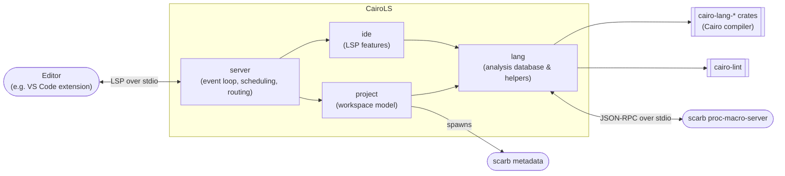
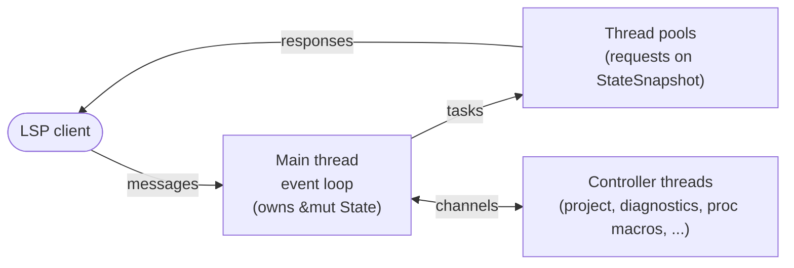
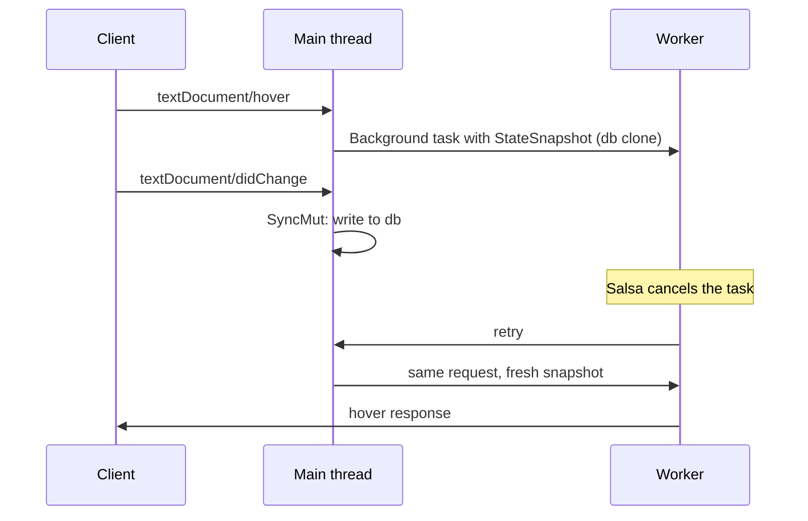
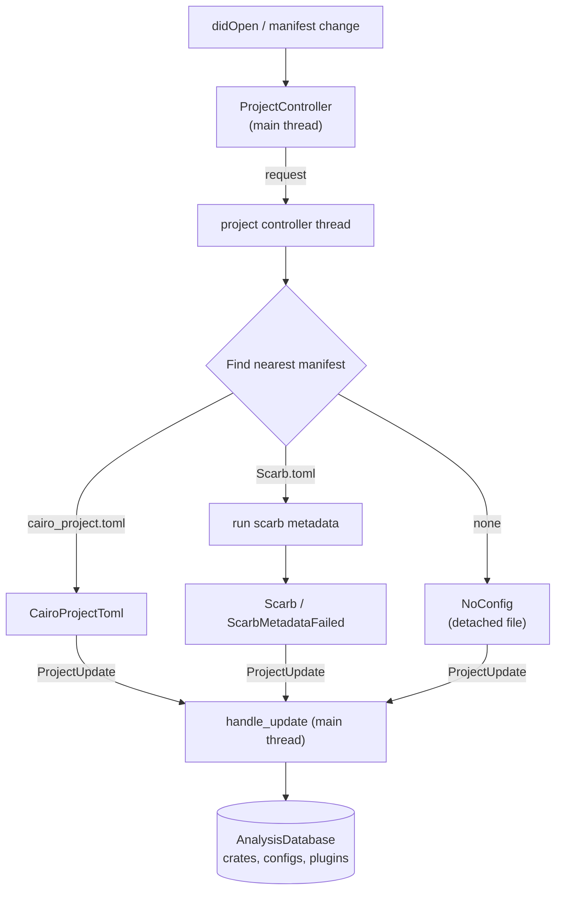
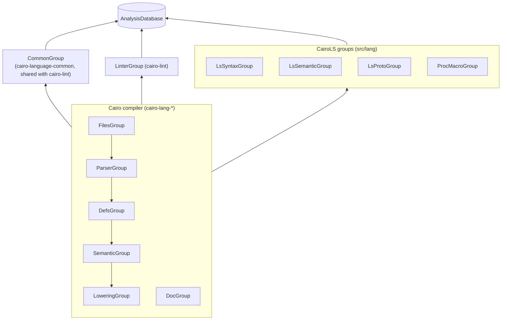
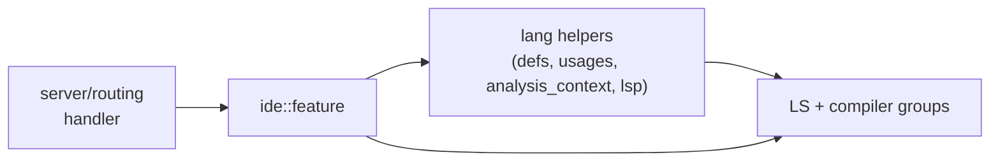
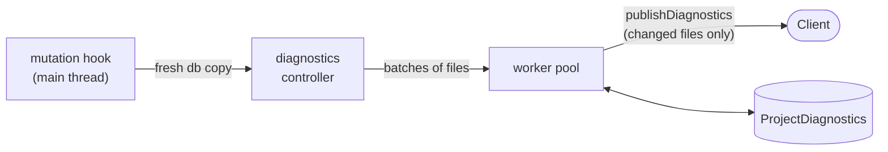
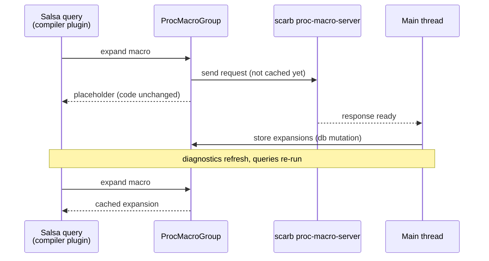

# CairoLS Architecture

## Bird's eye view

CairoLS is a [Language Server Protocol](https://microsoft.github.io/language-server-protocol/) implementation for Cairo.
It is shipped with [Scarb] and started by editors as `scarb cairo-language-server` or `cairo-language-server`.

CairoLS does not have its own compiler front-end.
It runs the Cairo compiler crates (`cairo-lang-*`) on a [Salsa](https://github.com/salsa-rs/salsa) database.
On top of that it adds:

- a project model built from `Scarb.toml` (via `scarb metadata`) or `cairo_project.toml`,
- procedural macro support through [Scarb]'s proc-macro-server,
- LSP features (completion, hover, navigation, ...) implemented as queries on that database.

The server runtime (event loop, task scheduling, routing) is adapted from [ruff_server](https://github.com/astral-sh/ruff/tree/main/crates/ruff_server).

## Code map

| Path                | Responsibility                                                                                                 |
|---------------------|----------------------------------------------------------------------------------------------------------------|
| `src/lib.rs`        | Entry point (`start()`), `Backend`, the main event loop.                                                       |
| `src/state.rs`      | `State` (owned by the main thread), `StateSnapshot` (read-only, used by background tasks), `MetaState`.        |
| `src/server/`       | LSP connection, scheduler and thread pools, request/notification routing and handlers.                         |
| `src/lsp/`          | Server capabilities, CairoLS-specific LSP extensions (`ext.rs`).                                               |
| `src/config.rs`     | Client configuration (`workspace/configuration`), can change at runtime.                                       |
| `src/env_config.rs` | Configuration through environment variables (logging, profiling, tuning).                                      |
| `src/project/`      | Discovering and loading workspaces, applying crates and their configs to the database.                         |
| `src/toolchain/`    | Locating and running [Scarb].                                                                                  |
| `src/lang/`         | `AnalysisDatabase`, symbol resolution, find usages, diagnostics, proc macros, LSP ↔ Cairo conversions.         |
| `src/ide/`          | One module per LSP feature: completion, hover, navigation, code actions, code lens, formatting, inlay hints... |
| `tests/e2e/`        | End-to-end test suite with a mock language client.                                                             |
| `tests/scarb_*`     | Example procedural macros (v1 and v2 API) used by tests.                                                       |
| `xtask/`            | Maintenance scripts (`cargo xtask upgrade`, `cargo xtask sync-version`).                                       |
| `website/`          | User documentation site.                                                                                       |

## Runtime

### Threads and the event loop

The main thread runs a single event loop which waits on several channels:
LSP messages, project updates, proc-macro responses, analysis status, retries and a few others.
Project updates are handled first, because they change the state the most.

All long-running work happens outside the main thread.
Requests run on thread pools.
Controller threads load projects, compute diagnostics and talk to the proc-macro server.
Threads communicate only through channels.

### Tasks

Every incoming message becomes a `Task` (see `src/server/schedule/`):

| Task kind    | Runs on        | Access              | Used for                                                    |
|--------------|----------------|---------------------|-------------------------------------------------------------|
| `SyncMut`    | main thread    | `&mut State`        | Notifications (`didOpen`, `didChange`, ...), state changes. |
| `Sync`       | main thread    | `&State`            | Small read-only actions.                                    |
| `Background` | worker pool    | `StateSnapshot`     | Almost all LSP requests (hover, completion, ...).           |
| `Fmt`        | fmt pool       | `StateSnapshot`     | Formatting, so it is never blocked by other requests.       |

Request and notification handlers are registered in `src/server/routing/`.

After every `SyncMut` task that changed the database or config, the scheduler runs hooks which:

1. may swap the database (see [Memory management](#memory-management)),
2. refresh diagnostics,
3. mark that analysis is in progress.

Tasks do not need to schedule these themselves.

### Cancellation

CairoLS cancels from the inside.
Any write to the database makes Salsa cancel queries running on all snapshots.
Handlers catch this, and either retry the request on a fresh snapshot or answer with `ServerCancelled`.
`$/cancelRequest` from the client is ignored.

### File changes

Document notifications run as `SyncMut` tasks:

- `didOpen` / `didChange` set the editor content as a file override in the database (full sync).
- `didOpen` also asks the project controller to load the project for the file.
- `didSave` / `didClose` remove the override, so the database reads the file from disk again.
- Watched file changes to `Scarb.toml` / `cairo_project.toml` reload the config and the project model and restart the proc-macro server.

## Project model

`src/project/` turns a file path into crates in the database:

1. The project controller thread finds the nearest manifest for an opened file.
   `cairo_project.toml` takes precedence over `Scarb.toml`.
2. For [Scarb] projects it runs `scarb metadata` and extracts crates from it.
   This is the expensive part, which is why it runs on its own thread.
3. The result (`ProjectUpdate`) is sent back to the main loop.
   It is applied to the database there: crate roots, crate settings, and the plugin list for each crate.
4. `ProjectModel` keeps all loaded workspaces, because one LS session can have many of them.
   `ConfigsRegistry` keeps per-package settings, such as `[tool.cairo-lint]`.

Detached files and `cairo_project.toml` projects get an unmanaged corelib if no `core` crate is loaded.
[Scarb] manifest errors are published as diagnostics on `Scarb.toml`.

## Analysis database

`AnalysisDatabase` (`src/lang/db/`) is a single Salsa database that holds only storage.
All functionality comes from extension traits ("groups") implemented for any Salsa database:

- the compiler groups, from `cairo-lang-*` crates,
- `CommonGroup` from `cairo-language-common`, shared with cairo-lint,
- LS-specific groups:
  - `LsSyntaxGroup`: finding syntax nodes at a position,
  - `LsSemanticGroup`: mapping syntax nodes to semantic items,
  - `LsProtoGroup`: mapping between LSP URLs and compiler files (including virtual ones),
  - `ProcMacroGroup`: proc-macro server state and cached expansions.

New database functionality should be added as such a group, not as fields on `AnalysisDatabase`.

### Compiler plugins

Each crate gets a list of compiler plugins, in the same order as [Scarb] uses:
config plugin, proc macros, default plugins, built-in plugins (Starknet, test, executable, ...) and cairo-lint's allow plugin.
Proc-macro plugins are added and removed at runtime, when the proc-macro server reports which macros are available.

## `lang` and `ide`

- `lang` is the semantic toolkit built on the database.
  The most important parts:
  - `lsp`: conversions between LSP and compiler types (positions, spans, locations),
  - `defs`: resolving the symbol at a position (`SymbolSearch` → `SymbolDef`),
  - `usages`: finding references of a `SymbolDef`,
  - `analysis_context`, `importer`, `methods`, `visibility`, ...: helpers for completion and code actions.
- `ide` has one module per LSP feature.
  A feature is mostly a function of request params and `&AnalysisDatabase` that returns the LSP response.
  It does not hold state (except `code_lens` and `analysis_progress`).

A typical request, for example goto definition:

1. Convert the LSP URL and position to a compiler file and offset (`LsProtoGroup`, `lang::lsp`).
2. Find the syntax node at that offset (`LsSyntaxGroup`).
3. Map it to nodes in macro-generated code, because user code may be expanded by macros (`CommonGroup`).
4. Resolve the symbol (`lang::defs`), which uses compiler semantic queries.
5. Map the result back to user code and convert it to an LSP location.

## Diagnostics

Diagnostics are computed for the whole project, not only for open files (`src/lang/diagnostics/`):

1. After each mutation, the main thread gives the diagnostics controller a fresh copy of the database.
   A newer refresh cancels the one that is running.
2. Open files are checked first, then all other files of the project.
   Files are split into batches processed by a small worker pool.
3. Each file collects parser, semantic and lowering diagnostics.
   If the linter is enabled, cairo-lint diagnostics are added too.
   Dependencies from the [Scarb] cache only report errors.
4. Only files whose diagnostics changed are published.

When the whole analysis is finished, the main loop saves the proc-macro cache and asks the client to refresh code lenses and semantic tokens.

## Procedural macros

`src/lang/proc_macros/` integrates procedural macros:

- `ProcMacroClientController` starts `scarb proc-macro-server` and restarts it after failures (rate-limited).
- The server status and all expansion results are a Salsa input (`ProcMacroGroup`).
- Compiler plugins never wait for the server.
  On a cache miss they send a request and return a placeholder.
  When responses arrive, the main thread writes them into the database, and analysis runs again.
- Expansions are also cached on disk in the `target` directory, so a new LS session starts faster.

## Memory management

Salsa never frees memoized results, so memory grows during long sessions.
`AnalysisDatabaseSwapper` (`src/lang/db/swapper.rs`) replaces the whole database with a fresh one:
after a number of mutations, or after a period of inactivity.

`src/lang/db/migration.rs` builds the fresh database.
It copies only the inputs: plugins, proc-macro state, file overrides and crate configuration.
The diagnostics controller uses the same migration for each refresh.

## Testing

- E2E tests live in `tests/e2e/`, one directory per feature, all compiled into one test binary.
- `sandbox!` creates a temporary project and starts the server with an in-memory connection and a `MockClient`.
- Most tests use inline [insta](https://insta.rs/) snapshots.
  A feature implements the `Transformer` trait, then tests use `test_transform_plain!` or `test_transform_with_macros!`.
- `test_transform_with_macros!` runs against the example macros in `tests/scarb_procedural_macros_v2`.
- The `testing` cargo feature exposes test-only parts of the server (e.g. `BackendForTesting`).

## Dependencies and versioning

- CairoLS is versioned together with the Cairo compiler.
- `cairo-lang-*`, `cairo-lint` and related crates are always declared as crates.io dependencies.
  During development they can be pinned to git revisions in `[patch.crates-io]`.
  [Scarb], which ships CairoLS, sets the final revisions for the whole toolchain.
- Use `cargo xtask upgrade` to change these dependencies.
  See [MAINTAINING.md](./MAINTAINING.md) for the release process.

## Rules of thumb

- Only `SyncMut` tasks on the main thread mutate `State` or the database.
  They block the event loop, so keep them short.
  Slow work (e.g. `scarb metadata`) goes to a controller thread and returns to the main loop through a channel.
- Cancellation is not an error.
  If you catch panics, detect Salsa cancellation with `is_cancelled` and re-raise it.
- IDs like `FileId` or `CrateId` belong to one database instance.
  They are invalid after a swap and in the diagnostics database.
  State kept outside the database uses stable keys, such as `Url` or `CrateInput`.
- Database inputs set at runtime must be copied in `migration.rs`, otherwise they are lost on a swap.
- Code may live in macro-generated virtual files.
  Map nodes and locations between user code and generated code (e.g. `get_node_resultants`, `get_originating_location`).
- `Config` can change at runtime.
  Read it from `State` or `StateSnapshot` instead of keeping your own copy.

[Scarb]: https://github.com/software-mansion/scarb
