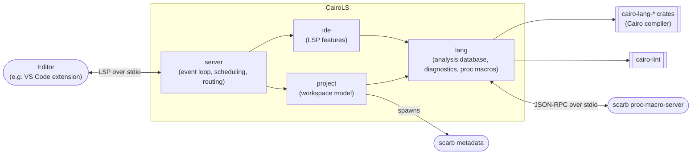
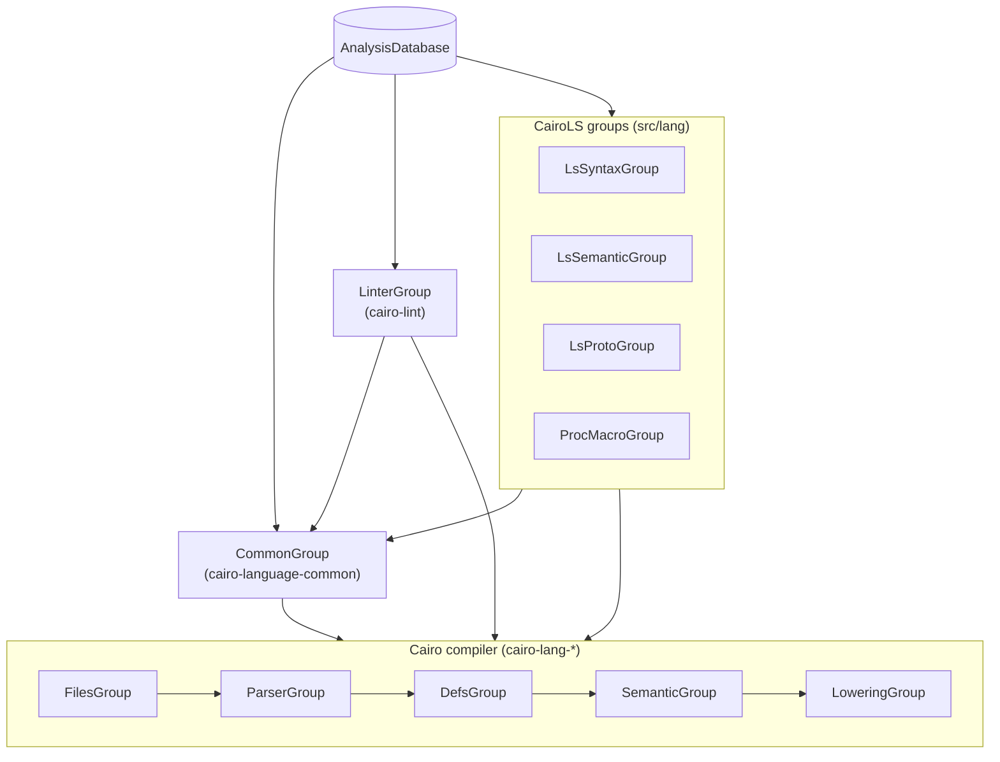
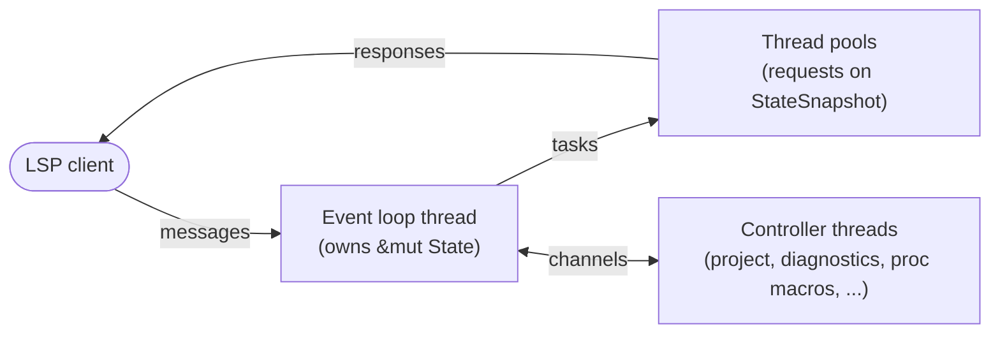
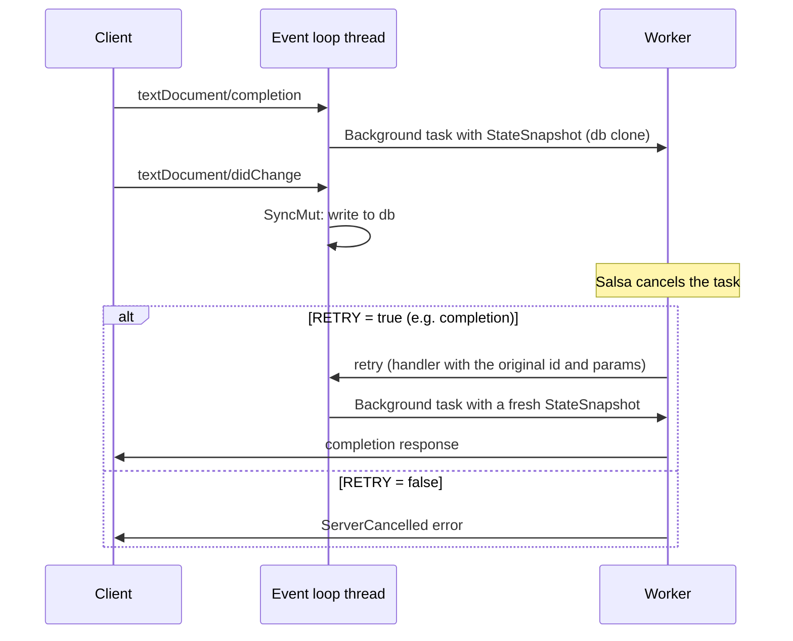
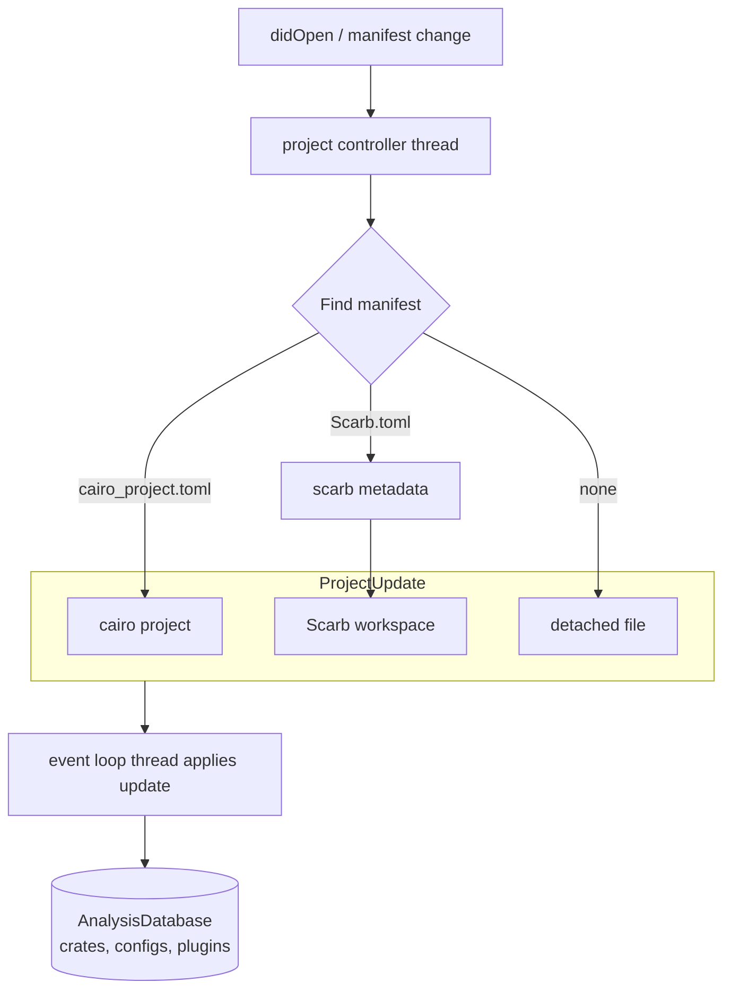
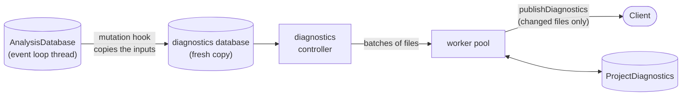
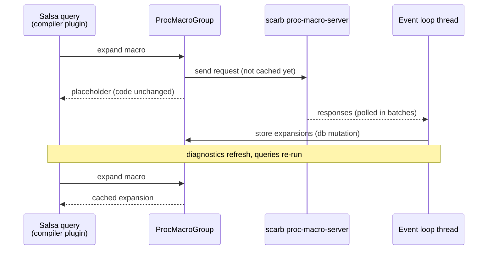

# CairoLS Architecture

CairoLS is a [Language Server Protocol](https://microsoft.github.io/language-server-protocol/) implementation for Cairo.
It is shipped with [Scarb] and started by editors as `scarb cairo-language-server`.

This document goes from general to specific:

1. [Concepts](#concepts) explain the layers CairoLS is built from.
2. [Module breakdown](#module-breakdown) shows where they live in the code.
3. [Implementation details](#implementation-details) describe how the most important mechanisms work.

## Table of contents

- [Bird's eye view](#birds-eye-view)
- [Concepts](#concepts)
  - [Cairo compiler and Salsa](#cairo-compiler-and-salsa)
  - [Analysis database](#analysis-database)
  - [Project model](#project-model)
  - [Macros and resultants](#macros-and-resultants)
  - [Compiler plugins](#compiler-plugins)
  - [Threads and the event loop](#threads-and-the-event-loop)
  - [Tasks](#tasks)
- [Module breakdown](#module-breakdown)
  - [`server`](#server)
  - [`project`](#project)
  - [`lang`](#lang)
  - [`ide`](#ide)
- [Implementation details](#implementation-details)
  - [Cancellation](#cancellation)
  - [File changes](#file-changes)
  - [Project loading](#project-loading)
  - [Diagnostics](#diagnostics)
  - [Procedural macros](#procedural-macros)
  - [Memory management](#memory-management)
- [Testing](#testing)
- [Dependencies and versioning](#dependencies-and-versioning)
- [Rules of thumb](#rules-of-thumb)

## Bird's eye view

CairoLS does not have its own compiler front-end.
It runs the Cairo compiler crates (`cairo-lang-*`) on a [Salsa](https://github.com/salsa-rs/salsa) database.
On top of that it adds:

- a project model built from `Scarb.toml` (via `scarb metadata`) or `cairo_project.toml`,
- procedural macro support through [Scarb]'s proc-macro-server,
- LSP features (completion, hover, navigation, ...) built on the queries of that database.

Arrows in the diagram show the main direction of use, not strict layering.

## Concepts

### Cairo compiler and Salsa

The Cairo compiler is written as Salsa queries: functions of a database whose results are memoized.
A query runs again only when something it read has changed.
CairoLS sets the inputs (contents of open files, crates, plugins) and asks the compiler queries for results.
Files that are not open are read from disk, which Salsa does not track (see [File changes](#file-changes)).

Three facts about how Salsa is used here shape the rest of this document:

- Background threads read the database through clones of it.
- A write cancels the queries running on other clones and waits until those clones are dropped
  (see [Cancellation](#cancellation)).
- Memoized results stay in memory (see [Memory management](#memory-management)).

### Analysis database

`AnalysisDatabase` is a single Salsa database that holds only storage.
All functionality comes from extension traits ("groups") implemented for any Salsa database.
Arrows mean "builds on".
The LS-specific groups are:

- `LsSyntaxGroup`: finding syntax nodes at a position,
- `LsSemanticGroup`: mapping syntax nodes to semantic items,
- `LsProtoGroup`: mapping between LSP URLs and compiler files (including virtual ones),
- `ProcMacroGroup`: proc-macro server state and cached expansions.

Two groups come from other crates:

- `CommonGroup` (`cairo-language-common`): helpers that both CairoLS and cairo-lint need,
  such as finding the syntax node at an offset or computing [resultants](#macros-and-resultants).
  They live in a separate crate, so both tools use one implementation.
- `LinterGroup` (`cairo-lint`): the linter used as a library.
  CairoLS calls it to compute lint diagnostics and to offer their fixes as code actions.

### Project model

The database has to know which crates exist and how they are configured.
The project model provides that.
It is extended when a file is opened: CairoLS finds the project of that file, which is one of:

- a [Scarb] workspace (`Scarb.toml`, read with `scarb metadata`),
- a `cairo_project.toml` project,
- nothing, for a detached file.

One LS session can have many workspaces loaded at the same time.
See [Project loading](#project-loading) for how the model is built.

### Macros and resultants

Macros rewrite the code before it is analyzed.
In Cairo they are compiler plugins: built-in ones (e.g. `#[derive]`, `#[generate_trait]`),
inline macros (e.g. `println!`) and procedural macros loaded by [Scarb].

A macro puts the code it generates into a virtual file.
That file is a child of the file where the macro was used.
Generated code can use macros too, so one user file can have a whole tree of virtual files.
A macro can also remove the code it was applied to.

The compiler has semantic information only for code that is left after expansion.
So a node from a user file is first mapped to its *resultants*:
the nodes it became after all expansions, without the removed ones.

Two examples:

- An attribute macro like snforge's `#[test]` replaces the function it is applied to.
  The original function is removed, so its only resultant is the function in the generated file.
- `#[generate_trait]` keeps the annotated `impl` and adds a trait in a virtual file.
  The trait name in user code has two resultants: itself and the generated trait name.

Features cross this boundary in both directions:

- User code → generated code: `get_node_resultants` (`CommonGroup`) returns the resultants of a node,
  and the feature analyzes each of them.
- Generated code → user code: `get_originating_location` maps a result found in a virtual file
  back to a location in user code, before it is sent to the client.

See [Procedural macros](#procedural-macros) for how procedural macros are expanded.

### Compiler plugins

Each [Scarb] crate gets the same compiler plugins, in the same order, as [Scarb] would use.
`cairo_project.toml` projects and detached files use a default plugin set.
Proc-macro plugins are added when the proc-macro server reports the available macros, and removed when it restarts.

### Threads and the event loop

The event loop runs on its own thread, not on the main thread of the process.
This document calls it the event loop thread.
It waits on several channels:
LSP messages, project updates, proc-macro responses, analysis status, retries and a few others.
Project updates are handled first, because they change the state the most.

`State` holds everything the server knows, including the database, and belongs to the event loop thread.
Other threads do not share it; they receive what they need on demand.

Requests that only read the state are background requests: they run on thread pools.
Each of them receives a `StateSnapshot` when it is scheduled:
a read-only view of `State` with its own database clone (see [Cancellation](#cancellation)).
The exception is `MetaState`, a little state behind a mutex, which background tasks can also change.

Slow work that is not a request runs on controller threads.
This pattern is used for project loading, diagnostics, proc-macro responses, analysis progress and code lenses:

- A controller is a struct kept in `State`.
- It owns a thread and stops it when it is dropped.
- A controller method sends the work to that thread and returns at once.
  It uses a channel, or a trigger when only the newest request matters (diagnostics).
- Most threads report back through a channel that the event loop waits on,
  and the result is applied there as a task (e.g. `ProjectUpdate`).

### Tasks

Every incoming message becomes a `Task`:

| Task kind    | Runs on           | Access          | Used for                                                                                                         |
|--------------|-------------------|-----------------|------------------------------------------------------------------------------------------------------------------|
| `SyncMut`    | event loop thread | `&mut State`    | Notifications (`didOpen`, `didChange`, ...) triggering state changes.                                            |
| `Sync`       | event loop thread | `&State`        | Small read-only actions, used to enforce no state mutation and to skip the hooks that run after `SyncMut` tasks. |
| `Background` | worker pool       | `StateSnapshot` | Almost all LSP requests (hover, completion, ...).                                                                |
| `Fmt`        | fmt pool          | `StateSnapshot` | Formatting, so it is never blocked by other requests.                                                            |

After every `SyncMut` task that changed the database inputs or client config, the scheduler runs hooks which:

1. may swap the database (see [Memory management](#memory-management)),
2. refresh diagnostics,
3. mark that analysis is in progress.

Tasks do not need to schedule these themselves.

## Module breakdown

| Path                | Responsibility                                                                                                 |
|---------------------|----------------------------------------------------------------------------------------------------------------|
| `src/lib.rs`        | Entry point (`start()`), `Backend`, the event loop.                                                            |
| `src/state.rs`      | `State` (owned by the event loop thread), `StateSnapshot` (read-only, used by background tasks), `MetaState`.  |
| `src/server/`       | LSP connection, scheduler and thread pools, request/notification routing and handlers.                         |
| `src/lsp/`          | Server capabilities, CairoLS-specific LSP extensions (`ext.rs`).                                               |
| `src/config.rs`     | Client configuration (`workspace/configuration`), can change at runtime.                                       |
| `src/env_config.rs` | Configuration through environment variables (logging, profiling, tuning).                                      |
| `src/project/`      | Discovering and loading workspaces, applying crates and their configs to the database.                         |
| `src/toolchain/`    | Locating and running [Scarb].                                                                                  |
| `src/lang/`         | `AnalysisDatabase`, symbol resolution, find usages, diagnostics, proc macros, LSP ↔ Cairo conversions.         |
| `src/ide/`          | One module per LSP feature: completion, hover, navigation, code actions, code lens, formatting, inlay hints... |
| `tests/e2e/`        | End-to-end test suite with a mock language client.                                                             |
| `tests/scarb_*`     | Example procedural macros (v1 and v2 API) used by tests.                                                       |
| `xtask/`            | Maintenance scripts (`cargo xtask upgrade`, `cargo xtask sync-version`).                                       |
| `website/`          | User documentation site.                                                                                       |

The four biggest modules are described below.

### `server`

The server runtime (task scheduling, routing and the event loop in `src/lib.rs`) is adapted from [ruff_server](https://github.com/astral-sh/ruff/tree/main/crates/ruff_server).

- `schedule`: `Task`, the scheduler and the thread pools (see [Tasks](#tasks)).
- `routing`: request and notification handlers are registered here.

### `project`

`project` finds the project of every opened file and loads its crates into the database
(see [Project loading](#project-loading)).

- `ProjectModel` keeps all loaded [Scarb] workspaces.
- `ConfigsRegistry` keeps per-package settings, such as `[tool.cairo-lint]`.

### `lang`

`lang` is the semantic toolkit built on the database.
The most important parts:

- `db`: `AnalysisDatabase`, `LsSyntaxGroup` and `LsSemanticGroup` (see [Analysis database](#analysis-database)),
  database swapping and migration (see [Memory management](#memory-management)),
- `lsp`: `LsProtoGroup` and conversions between LSP and compiler types (positions, spans, locations),
- `defs`: resolving the symbol at a position (`SymbolSearch` → `SymbolDef`),
- `usages`: finding references of a `SymbolDef`,
- `diagnostics`: computing and publishing diagnostics (see [Diagnostics](#diagnostics)),
- `proc_macros`: the proc-macro server client and `ProcMacroGroup` (see [Procedural macros](#procedural-macros)),
- smaller helpers used by completion and code actions.

### `ide`

`ide` has one module per LSP feature.
A feature is mostly a function of request params and `&AnalysisDatabase` that returns the LSP response.
Features are mostly stateless; the few that keep state use a controller owned by `State`.

A typical request, for example goto definition:

1. Convert the LSP URL and position to a compiler file and offset (`LsProtoGroup`, `lang::lsp`).
2. Find the syntax node at that offset (`LsSyntaxGroup`).
3. Map it to its [resultants](#macros-and-resultants): the nodes it became after macro expansion (`CommonGroup`).
4. Resolve the symbol (`lang::defs`), which uses compiler semantic queries.
5. Map the result back to user code and convert it to an LSP location.

## Implementation details

### Cancellation

CairoLS cancels from the inside.
Any write to the database makes Salsa cancel queries running on all snapshots.
The write waits until all other database clones are dropped.
Handlers catch the cancellation:
requests marked `RETRY = true` (e.g. completion, semantic tokens) are retried by the server on a fresh snapshot,
so the client does not have to send them again.
Others answer with `ServerCancelled`.
`$/cancelRequest` from the client is ignored.

### File changes

Document notifications run as `SyncMut` tasks:

- `didOpen` / `didChange` set the editor content as a file override in the database (full sync).
- `didOpen` also asks the project controller to load the project for the file.
- `didSave` / `didClose` remove the override, so the database reads the file from disk again.
- Salsa does not track reads from disk.
  The compiler query that reads a file (`priv_raw_file_content`) calls `db.report_untracked_read()`,
  so it runs again in every new revision.
  `didSave` and watched `.cairo` file changes do a synthetic write (`cancel_all`) to start a new revision.
- Watched file changes to `Scarb.toml` / `cairo_project.toml` reload the client configuration (`workspace/configuration`)
  and the project model, and restart the proc-macro server.

### Project loading

Loading runs on a separate thread because `scarb metadata` may be slow.
The result is applied to the database on the event loop thread.

- The controller looks in parent directories for `cairo_project.toml` and `Scarb.toml`.
  If both exist, `cairo_project.toml` wins.
- Workspaces that are already loaded are skipped.
- Files from the [Scarb] cache (downloaded dependencies) never load a project of their own.
  This is a deliberate decision.
  Such a file is usually opened by goto definition, and it is already analyzed as a dependency of the user's project.
  The consequence is that its `#[cfg(test)]` code is not analyzed, because dependencies do not get the `test` cfg.
  We want that: it saves memory and time.
- [Scarb] gives its workspaces the `core` crate (corelib).
  Other projects do not get one, so CairoLS finds it on its own: this is the *unmanaged* corelib.
  It comes from the `cairo1.corelibPath` setting, or else from the corelib shipped with [Scarb].
  It is set up if no `core` crate is loaded:
  for detached files, `cairo_project.toml` projects, or when `scarb metadata` fails.
- [Scarb] manifest errors are published as diagnostics on `Scarb.toml`.

### Diagnostics

Diagnostics are computed for the whole project, not only for open files (`src/lang/diagnostics/`):

1. After each mutation, the event loop thread copies the inputs of its database into a fresh one
   (see [Memory management](#memory-management)) and hands the copy to the diagnostics controller.
   A newer refresh cancels the one that is running.
2. Open files are checked first, then all other files of the project.
   Files are split into batches processed by a small worker pool.
3. Each file collects parser, semantic and lowering diagnostics.
   If the linter is enabled, cairo-lint diagnostics are added too.
   Dependencies from the [Scarb] cache only report errors.
4. `ProjectDiagnostics` keeps the last published diagnostics per file, so only changes are sent.

One run does not mean that the analysis is finished.
Proc-macro responses that arrive during a run are written into the database, which starts a new run
(see [Procedural macros](#procedural-macros)).
`AnalysisProgressController` reports the analysis as finished only when a run ends without being cancelled
and all proc-macro requests sent so far have been answered.
Then the event loop saves the proc-macro expansion cache to disk and asks the client to refresh code lenses and semantic tokens.

### Procedural macros

`src/lang/proc_macros/` integrates procedural macros:

- `ProcMacroClientController` starts `scarb proc-macro-server` and restarts it after failures (rate-limited).
- The server status and all expansion results are a Salsa input (`ProcMacroGroup`).
- Compiler plugins never wait for the server.
  On a cache miss they send a request and return a placeholder.
- The event loop thread collects the ready responses and writes them into the database in one go.
  It does so early in a diagnostics run, as soon as the run has requested all its macros, and at least every 3 seconds.
  This is a mutation, so analysis runs again.
- Expansions are also cached on disk in the `target` directory, so a new LS session starts faster.

### Memory management

Salsa never frees memoized results, so memory grows during long sessions.
`AnalysisDatabaseSwapper` (`src/lang/db/swapper.rs`) replaces the whole database with a fresh one:
after a number of mutations, or after a period of inactivity.

`src/lang/db/migration.rs` builds the fresh database.
It copies only the inputs: plugins, proc-macro state, file overrides and crate configuration.
The diagnostics controller uses the same migration for each refresh.

## Testing

- E2E tests live in `tests/e2e/`, one directory per feature, all compiled into one test binary.
- `sandbox!` creates a temporary project and starts the server with an in-memory connection and a `MockClient`.
  It disables proc macros and the linter unless the test's workspace configuration enables them.
- Most tests use inline [insta](https://insta.rs/) snapshots.
  A feature implements the `Transformer` trait, then tests use `test_transform_plain!` or `test_transform_with_macros!`.
- `test_transform_with_macros!` runs against the example macros in `tests/scarb_procedural_macros_v2`.
- The `testing` cargo feature exposes test-only parts of the server (e.g. `BackendForTesting`).

## Dependencies and versioning

- CairoLS is versioned together with the Cairo compiler.
- `cairo-lang-*`, `cairo-lint` and related crates are always declared as crates.io dependencies.
  During development they can be pinned to git revisions in `[patch.crates-io]`.
  [Scarb], which ships CairoLS, sets the final revisions for the whole toolchain.
- Use `cargo xtask upgrade` to change these dependencies.
  See [MAINTAINING.md](./MAINTAINING.md) for the release process.

## Rules of thumb

- Only `SyncMut` tasks on the event loop thread mutate `State` or the database.
  They block the event loop, so keep them short.
  Slow work goes to a controller thread and returns to the event loop through a channel.
- A database write waits until all clones are dropped.
  Do not keep database clones longer than needed.
- Cancellation is not an error.
  If you catch panics, detect Salsa cancellation with `is_cancelled` and re-raise it.
- IDs like `FileId` or `CrateId` belong to one database instance.
  They are invalid after a swap and in the diagnostics database.
  State kept outside the database uses stable keys, such as `Url` or `CrateInput`.
- Database inputs set at runtime must be copied in `migration.rs` ([why](#memory-management)).
- Code may live in macro-generated virtual files.
  Map nodes and locations between user code and generated code ([how](#macros-and-resultants)).
- `Config` can change at runtime.
  Read it from `State` or `StateSnapshot` instead of keeping your own copy.

[Scarb]: https://github.com/software-mansion/scarb
